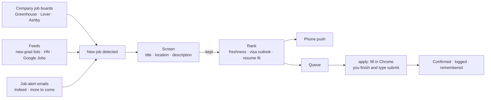

# ApplyPilot

**Find new early-career tech jobs minutes after they're posted, screen out the ones you can't take,
rank the rest, and apply on the employer's own site, with every application approved by you.**

ApplyPilot runs on your Mac. It watches company job boards directly (Greenhouse, Lever, Ashby), so it
sees postings before they're re-listed on LinkedIn or Indeed. It was built for an F-1 student's search:
software, ML and data roles in the US, where "no sponsorship" jobs stay in scope because OPT plus STEM OPT
covers about three years.

> **Full documentation** lives in [`docs/`](docs/README.md): idea and goals, architecture, tech stack,
> data schema, runbook, bugs and fixes, roadmap, and a dated progress log.

---

## Contents
1. [How it works](#how-it-works)
2. [What it does at each stage](#what-it-does-at-each-stage)
3. [Measured results](#measured-results)
4. [Ground rules](#ground-rules)
5. [Setup](#setup)
6. [Daily use](#daily-use)
7. [Command reference](#command-reference)
8. [Where your data lives](#where-your-data-lives)
9. [Project layout](#project-layout)
10. [Development](#development)
11. [Roadmap](#roadmap)

---

## How it works



1. **Discover.** Poll about 1,160 company boards every 2.5–15 minutes, plus community lists, HN
   "Who is hiring", Google Jobs and your job-alert emails.
2. **Screen.** Drop jobs you legally can't take or that aren't real jobs.
3. **Rank.** Score each remaining job and pick the best of six pre-built resumes for it.
4. **Alert.** Push good matches to your phone.
5. **Apply.** One command fills the application in Chrome; you complete what only you can answer and
   approve the submit.

---

## What it does at each stage

### 1. Discover
| Source | How | Notes |
|---|---|---|
| Company boards (Greenhouse, Lever, Ashby) | Tiered polling with ETag/304: hot every ~2.5 min, warm 15 min, cold 3 h | An unchanged board costs one `304`. A board's first scan is a silent baseline; every job id after that is new. |
| Board discovery | Curated list, actively hiring YC companies, USCIS H-1B employers | A prober finds which ATS each company uses. Feeds keep adding boards. |
| SimplifyJobs new-grad lists | Structured `listings.json`, conditional GET every 5 min | Every Greenhouse/Lever/Ashby link becomes a polled board |
| HN "Who is hiring" | Algolia API, new comments only | Companies are probed for their ATS |
| Google Jobs | JSearch API (optional key), paced to the monthly quota | Aggregator links are resolved to the employer's posting |
| Job-alert emails | Gmail API, **read-only**, OAuth with PKCE | Indeed today; LinkedIn, Glassdoor, ZipRecruiter, Dice and Handshake parsers are next. Tracking links are never opened. |

LinkedIn and Indeed are **never scraped**: their jobs arrive only through your alert emails and are
matched to the employer's own posting by company and title.

### 2. Screen
- **Title and location gate:** software, ML or data roles; not senior, lead or manager; not
  internships; US or US-remote.
- **Description hard drops:** U.S. citizenship or green card required, security clearance, ITAR or
  "U.S. persons only", OPT "training program" schemes, 4+ years of experience required.
- **Signals, never drops:** sponsorship stance ("no sponsorship" is labeled *OPT/STEM OPT path* and
  kept), E-Verify, H-1B history, "sponsorship now or in the future" wording.

The description rules read clauses with their section (requirements, preferred, other). So
equal-opportunity boilerplate and "clearance is a plus" don't drop a job. Every drop stores the
sentence that caused it.

### 3. Rank
A 0–100 score orders the queue. It never drops anything.

| Part | Points |
|---|---|
| Freshness | 0–35 (fades to 0 over two weeks) |
| New-grad title | 15 |
| Visa outlook | 4–20 |
| E-Verify | 10 |
| Apply path (polled ATS, other ATS, aggregator) | 0–10 |
| Resume fit: best of six variants on the ATS scorer | 0–20 |
| Knockouts (2–3 years, PhD, C2C, …) | penalties |

**Resume variants:** six one-page resumes (swe-backend, ai-engineer, ml-engineer, infra-platform,
fullstack-fde, data), each tailored to real archetype postings by the `/resumetailor` Claude Code skill
running headless. Each job is scored against all six and the best one is attached when you apply.

### 4. Alert
Phone pushes through [ntfy](https://ntfy.sh) plus a macOS banner, e.g.
`new-grad tech role, US · score 64 · fit 88 (ml-engineer) · no sponsorship: OPT/STEM OPT path · via Simplify`.

### 5. Apply (you approve every application)
1. `applypilot apply <#>` reads the form from the ATS's own API and answers each field from your
   `profile.yaml`, `answers.yaml` and **answer memory**.
2. It fills the form in a visible Chrome window, attaches the best resume, and **reads every field
   back** to verify it.
3. Everything only you can answer is **outlined in red** and listed in the terminal: legal notices
   (always yours), essays, unknown questions.
4. It submits **only after you type `submit`**, and counts the application only when a confirmation
   page appears. Form errors send you back to fix them.
5. It logs the answers, screenshots and confirmation, then offers to **remember** the answers you
   typed, so the same question fills itself next time.

At most 3 applications per company per 30 days, and never twice to the same job.

---

## Measured results
*(from the progress log, October 2026)*

| What | Result |
|---|---|
| Boards watched | 1,166 (623 Ashby, 398 Greenhouse, 145 Lever) |
| Full poll of all boards | ~6 s when unchanged (mostly `304`s) |
| Detection latency via board polls | p50 **1.5 min**, p95 2.5 min |
| Hard-drop accuracy (73 hand-labeled excerpts) | 35/35 drops caught, 0/38 false drops, 0/12 "no sponsorship" jobs dropped |
| Fields answered from your files (60 real forms) | 67% of required fields; the rest need you (legal notices, essays, …) |
| Dry-run fills (12 forms across all three ATSs) | 106 fields filled and verified, 0 mismatches, 0 failures |
| Resume variants (ATS score on their archetypes) | 94, 94, 92, 91, 88, 78 |

---

## Ground rules
- **You approve every application.** There is no unattended submit.
- **CAPTCHAs are never solved or bypassed.** You solve them in the window.
- **Legal notices are always yours to read and accept.**
- **Nothing is guessed.** An answer comes from your own files, or the question goes to you with the
  reason.
- **Only public, read-only job APIs.** No LinkedIn or Indeed scraping; nothing logs in to job sites.
- **Your data stays on your Mac.** Profile, answers, keys, tokens and the database live in
  `~/.applypilot/` and never enter this repo.

---

## Setup

**Requirements:** macOS, Python 3.12 via [uv](https://docs.astral.sh/uv/), Google Chrome. Optional:
the Claude Code CLI (resume variants), a Google Cloud OAuth client (Gmail alerts), a JSearch API key.

```bash
git clone <this repo> && cd applypilot
uv sync
export PYTHONPATH=src                     # see "macOS note" below
uv run applypilot init                    # creates ~/.applypilot: config, database, profile and answers templates
```

1. **Fill in your details** in `~/.applypilot/profile.yaml` (name, contact, links, education, resume
   path) and `~/.applypilot/answers.yaml` (work authorization, sponsorship now and future,
   availability, EEO choices).
2. **Phone alerts:** install the ntfy app and subscribe to the topic in
   `~/.applypilot/config.yaml` (`ntfy_topic`). Treat the topic like a password. Test it with
   `uv run applypilot test-push`.
3. **Seed the boards and take the first baseline:**
   ```bash
   uv run applypilot seed curated && uv run applypilot seed yc && uv run applypilot seed h1b
   caffeinate -i uv run applypilot poll
   caffeinate -i uv run applypilot feeds poll --force
   ```
4. **Run it in the background** (launchd: starts at login, restarts on crash, keeps the Mac awake):
   ```bash
   uv run applypilot agent install       # rerun after every code change
   ```
5. **Optional:**
   - **Gmail alerts:** create a Desktop OAuth client with the `gmail.readonly` scope, save it as
     `~/.applypilot/gmail_client_secret.json` (mode 600), then run `uv run applypilot gmail login`.
   - **Google Jobs:** `uv run applypilot feeds set-key jsearch` (typed hidden).
   - **Resume variants:** put archetype postings in `<resume dir>/variants/<name>/jd.txt`, then run
     `uv run applypilot variants build` (uses Claude usage).

**macOS note:** uv marks `.venv` hidden, and Python 3.12.13 skips hidden `.pth` files, which breaks the
editable install (`No module named applypilot`). The Makefile and the launchd agent set
`PYTHONPATH=src` for you; set it yourself in a shell.

---

## Daily use

Run these in your own Terminal: `apply` waits for your input.

```bash
cd applypilot && export PYTHONPATH=src
uv run applypilot queue           # best jobs to apply to, numbered
uv run applypilot plan 3          # optional: every question, the answer and its source, what needs you
uv run applypilot apply 3         # Chrome fills the form → you finish the red fields → type 'submit'
uv run applypilot applications    # what you've applied to
```

---

## Command reference

| Area | Command | What it does |
|---|---|---|
| Setup | `init` | Create `~/.applypilot` with templates and an ntfy topic |
| | `agent install \| uninstall \| status` | Background polling via launchd |
| | `test-push` | Send a sample alert |
| Boards | `seed curated \| yc \| h1b` | Discover company boards |
| | `boards add <ats> <slug>` · `boards list` · `boards block <ats> <slug>` | Manage boards by hand |
| Polling | `poll` · `run` | One cycle, or forever (boards + feeds) |
| | `feeds poll` · `feeds list` · `feeds set-key jsearch` · `feeds test jsearch` | Cross-company feeds |
| | `resolve <url>` · `resolve --company X --title Y` | Any job link, or a LinkedIn/Indeed listing → the employer's ATS job |
| Gmail | `gmail login \| status \| test \| samples \| logout` | Read-only access to job-alert emails |
| Screening | `screen [--fetch-days N] [--all]` | Run the description filters and scores over stored jobs |
| | `jobs [--fresh] [--by-score]` · `stats` | Browse jobs; counts and detection latency |
| Resumes | `variants build [--only …] [--timeout …]` · `variants list` | Build the six resume variants |
| | `tailor <job>` | A resume tailored to one job |
| Applying | `queue` · `plan <#>` · `fill <#>` · `apply <#>` · `applications` | Pick, preview, dry-run, apply, log |
| | `memory list` · `memory forget <#>` | Answers remembered from earlier forms |

Every command takes `--help`.

---

## Where your data lives
Everything personal is outside the repo, in `~/.applypilot/`:

| File | Contents |
|---|---|
| `config.yaml` (mode 600) | Settings, ntfy topic, optional API keys |
| `profile.yaml`, `answers.yaml` | Your details and fixed screening answers (templates in `profile/`) |
| `answer_memory.yaml` | Answers remembered from earlier forms (editable) |
| `applypilot.db` | SQLite: boards, jobs, feeds, applications |
| `gmail_client_secret.json`, `gmail_token.json` (mode 600) | Gmail OAuth client and read-only token |
| `chrome-profile/` | The dedicated Chrome profile used to fill forms |
| `applications/`, `dryruns/` | Screenshots and per-field records |
| `poller.log`, `run.log` | Logs |

---

## Project layout
```
src/applypilot/
  cli.py                      Typer CLI (every command above)
  config.py  db.py  models.py Settings, SQLite schema and helpers, data classes
  sources/                    Greenhouse, Lever, Ashby board pollers
  poller.py                   Tiered conditional polling, baseline → diff, pushes
  seeds.py  resolver.py       Board discovery; URL / company+title → ATS job
  feeds/                      GitHub lists, HN, JSearch, alert emails, and the feed runner
  gmail.py                    Read-only Gmail OAuth client
  relevance.py  filters.py    Title/location gate; description hard drops and signals
  rank.py  fit.py  tailor.py  Score, resume fit, headless resume tailoring
  apply/                      forms (read), answers (rules), memory, filler (Chrome), submit (approve → confirm)
  notify.py  launchd.py       ntfy + macOS banners; background agent
tests/                        pytest + respx; fixtures trimmed from real API responses and forms
docs/                         Full documentation (see docs/README.md)
seeds/companies.txt           Curated company list
profile/                      Templates for profile.yaml and answers.yaml
```

---

## Development
```bash
make test                      # 170 tests (respx-mocked APIs, real-form fixtures, labeled filter eval)
uv run pytest -m browser       # 6 tests that drive a local Chrome against local pages (~50 s)
make lint                      # ruff
```
Tests never touch real employer sites. Browser tests use local HTML pages and a throwaway Chrome profile.

---

## Roadmap
| Phase | Scope | Status |
|---|---|---|
| 0–1 | Scaffold; Greenhouse/Lever/Ashby polling; seeding; alerts; background agent | ✅ |
| 2 | Resolver, new-grad lists, HN, Google Jobs, Gmail alerts (Indeed) | ✅ (more alert sites next) |
| 3 | Description screening, visa signals, ranking, resume variants and fit | ✅ |
| 4 | Read forms, answer, fill with readback, apply at the Mac, answer memory | ✅ built; validating on the first 20 live applications |
| next | Grounded essay drafts → background pre-fill → one-tap approval from the phone → daily digest | planned |
| 5 | Dashboard, application tracker, Workday | planned |

See [`docs/07-roadmap-and-improvements.md`](docs/07-roadmap-and-improvements.md) for known limitations
and the improvement backlog.

---

*Personal project, private repository.*
