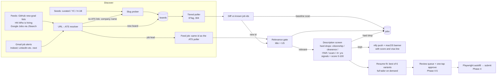
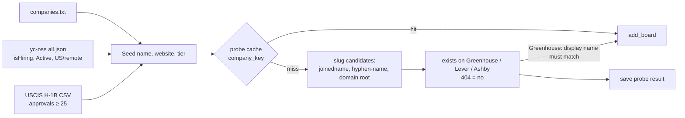
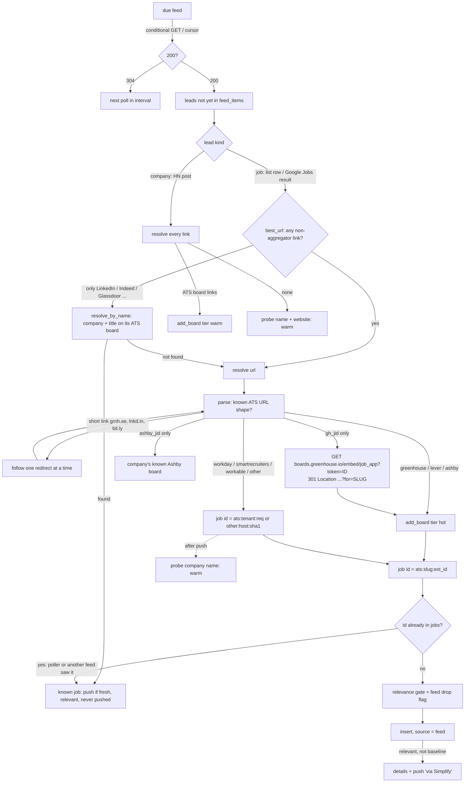

# 2. Architecture and workflow

_Reflects: Phase 4a (2026-10-22): discovery (boards, feeds, Gmail alerts), description screening and ranking, resume variants and fit, and form reading + dry-run filling. Planned stages are marked (Phase N)._

## 2.1 End-to-end pipeline



Solid arrows are built; dashed arrows are planned.

## 2.2 Components (Phase 1)

| Module | Responsibility |
|---|---|
| `config.py` | Loads `~/.applypilot/config.yaml` into a pydantic `Settings` (tiers, concurrency, ntfy, fresh window). `APPLYPILOT_HOME` overrides the location. |
| `models.py` | Dataclasses `Board`, `Job`, `BoardResult`; enum `ATS`. |
| `db.py` | SQLite (WAL) schema and every query: add/upgrade boards, due boards, poll bookkeeping, job insert/close/reopen, relevance, notifications, probe cache. |
| `sources/base.py` | `Source` protocol (`poll`, `details`, `exists`), `get_json` conditional GET, `html_to_text`, `iso_ts`. |
| `sources/greenhouse.py` | `GET boards-api.greenhouse.io/v1/boards/{slug}/jobs` (list without content); `details` fetches `/jobs/{id}` for the description; `exists` returns the board's display name. |
| `sources/lever.py` | `GET api.lever.co/v0/postings/{slug}?mode=json`; descriptions and lists included; `country` field. |
| `sources/ashby.py` | `GET api.ashbyhq.com/posting-api/job-board/{slug}?includeCompensation=true`; descriptions, compensation, secondary locations with countries. |
| `relevance.py` | `judge(job) -> Verdict(relevant, reason, new_grad)`; `is_us(job) -> True/False/None`. |
| `poller.py` | `Poller.poll_board`, `_diff`, `run_once`, `run_forever`; semaphores; tier intervals. |
| `seeds.py` | `slug_candidates`, `company_key`, `names_match`, `probe`, `add_companies`, and the `yc_seeds` / `h1b_seeds` / `file_seeds` loaders. |
| `notify.py` | `push()` to ntfy (Title/Click/Priority headers) and `osascript` banners; `age()` formatting. |
| `launchd.py` | Builds and installs `~/Library/LaunchAgents/com.applypilot.poller.plist`. |
| `resolver.py` | `parse(url) -> Link` (pure URL patterns for Greenhouse, Lever, Ashby, Workday, SmartRecruiters, Workable, `gh_jid` / `ashby_jid` embeds, anything else as `other`); `resolve()` adds short-link expansion, the Greenhouse embed redirect and board registration; `find_on_boards` / `resolve_by_name` map company + title to an ATS job. |
| `feeds/base.py` | `Feed` protocol (`fetch(client, etag, cursor)`), `Lead`, `FeedResult`. |
| `feeds/github_lists.py` | `GitHubList(repo)`: `listings.json` of SimplifyJobs-format repos, conditional GET on raw.githubusercontent. |
| `feeds/jsearch.py` | `JSearch(query)`: Google for Jobs via the JSearch API, one feed per query, paced to the monthly quota; `to_lead` orders direct apply options first. |
| `feeds/hn.py` | `HackerNews`: latest "Who is hiring?" thread via Algolia; new top-level comments only (cursor); `parse_post`, `company_name`. |
| `feeds/runner.py` | `FeedRunner`: due feeds → unseen leads → resolve → job row / boards / probes → relevance → push. |
| `cli.py` | Typer app (see [05-operations-runbook.md](05-operations-runbook.md)). `run` drives the board poller and the feed runner concurrently. |

## 2.3 The poll lifecycle (one board)

```mermaid
sequenceDiagram
    participant L as Poller loop
    participant DB as SQLite
    participant ATS as ATS API
    L->>DB: due_boards(now)  (next_poll <= now, tier not dead/blocked)
    L->>ATS: GET list  (If-None-Match: etag)
    alt 304 Not Modified
        L->>DB: record_poll(304) → next_poll = now + tier interval
    else 200 OK
        L->>DB: board_ids(board) → {ext_id: is_open}
        Note over L: new = current − known<br/>reopened = current ∩ closed<br/>gone = open − current
        L->>DB: reopen_jobs / close_jobs
        alt first successful scan (baseline)
            L->>DB: insert_jobs(is_baseline=1) + relevance
            Note over L: no per-job push; fresh (≤ 48 h) relevant jobs<br/>go to a digest; board with no US jobs → cold
        else later scan
            L->>L: judge(new jobs)
            L->>ATS: details(relevant)  (Greenhouse description)
            L->>DB: insert_jobs + set_relevance
            L-->>L: push(relevant) → mark_notified
            L->>DB: tier = hot (board posts early-career roles)
        end
        L->>DB: record_poll(200, new etag, baseline_done=1)
    else 404 / error
        L->>DB: fail_count++ → next poll at 2× interval; 3×404 → tier dead
    end
```

### Key rules
- **Baseline, then diff.** Adding 1,000 boards would otherwise push ~30,000 "new" jobs. The baseline
  is silent; only ids appearing afterwards count as new.
- **Ids, not timestamps.** New means "job id not seen on this board before", so we don't depend on
  each ATS's date semantics. `posted_at` is still stored, and used to measure detection latency.
- **Reopened ≠ new.** A job that disappears and comes back with the same id is reopened silently, so
  there are no duplicate alerts.
- **Descriptions only when needed.** The Greenhouse list endpoint is fetched without `content`
  (~10× smaller). The description is fetched per job, only for new relevant jobs.

## 2.4 Tiers

| Tier | Interval | How a board gets here |
|---|---|---|
| hot | 150 s ± 15% | Curated seed, H-1B ≥ 100 approvals, manual add, **linked from a new-grad list row**, or **posted a relevant job after its baseline** (auto-promotion) |
| warm | 900 s ± 15% | YC seeds, H-1B 25–99 approvals, boards linked from HN posts, boards found by **probing** a feed company's name (guesses start warm) |
| cold | 3 h ± 15% | **Baseline had no US-plausible jobs** (empty placeholder boards, non-US companies) |
| dead | never | 3 consecutive 404s (the board moved or closed) |
| blocked | never | Manual `boards block`: a slug collision with a different company. Re-seeding can't undo it. |

Errors (timeouts, 5xx) double the next interval for that board. `add_board` only ever **upgrades** a
tier, so re-seeding never demotes a board. The exception is a board that went **cold after its
baseline**: it stays cold when re-added (B-012); only the poller's own promotion on a new relevant job
lifts it.

## 2.5 Concurrency model
- A single asyncio event loop with one shared `httpx.AsyncClient` (keep-alive pool).
- A global semaphore (`max_concurrency`, default 24) plus a per-ATS semaphore (`per_host_concurrency`,
  default 6), so no single vendor gets more than 6 parallel requests.
- SQLite is used from the event-loop thread only (no cross-thread access), in autocommit/WAL mode.
- `run_forever` sleeps until the earliest `next_poll` (1–30 s), so the loop idles cheaply.

## 2.6 Seeding (how boards are discovered)



- Candidate order matters: name-based slugs come before the domain root (see bug B-003).
- The domain root is the registrable name (`jobs.cable.energy` → `cable`, `acme.co.uk` → `acme`), not
  the first host label (B-010).
- Greenhouse returns a display name, which `names_match` checks after removing generic board words
  ("Rubrik Job Board" → "Rubrik", B-011). Lever and Ashby don't, so a wrong match there needs
  `boards block`.
- "No board found" results expire after 30 days (1 day when `resolve_by_name` asks, since the company
  is hiring right now). Hits are cached for good.

## 2.7 Relevance gate (Phase 1)
Evaluated on the title and location only, in this order:
1. **Not a tech title** → drop (needs software / ML / AI / data / platform / SRE / forward-deployed …).
2. **Other field** → drop (mechanical, electrical, hardware, sales, recruiting, marketing, design,
   GTM/strategy …).
3. **Internship or co-op** → drop.
4. **Senior / staff / principal / lead / manager / III / IV** → drop, unless the title also reads as
   new grad.
5. **Location:**
   - The ATS country field wins.
   - Otherwise US hints (states, major cities, "United States", "Remote - US") → keep.
   - Non-US hints only → drop.
   - Bare "Remote" or "Hybrid" → keep.
   - Empty → keep, marked "location unknown".
6. The **new-grad flag** (new grad, entry level, junior, associate, university, early career,
   "Engineer I", 2026/2027) raises the push priority to high.

Title-level hard drop (added 2026-10-21): **cleared / clearance / TS/SCI / top secret / polygraph**
in the title → "requires security clearance". Description rules are in §2.10.

## 2.10 Description screening and ranking (Phase 3a)
`filters.assess(text)` (pure) and `rank.screen(conn, job)` (stores the result) run on every relevant
job before any push: board polls (after the Greenhouse description fetch), feed jobs, and known
baseline jobs a feed resurfaces. `applypilot screen` backfills stored jobs.

**How a description is read.** The text is cut into clauses: lines, bullets, sentences (not after
"U.S." or "e.g."), and ";". Each clause carries a section:
- `req`: after a short header such as Requirements / Qualifications / What you'll need / You'll thrive.
- `pref`: after Preferred / Nice to have / Bonus / What we value.
- `other`: after About us / Benefits / EEO / Additional information / Please note / Work authorization.
A clause is *soft* if it sits in `pref` (unless it says must / only / required outright) or contains a
softener (preferred, a plus, beneficial, not required, desired …) outside parentheses. Bare headers
("Clearance:") are skipped.

**Hard drops** (first match wins; the job becomes `relevant=0`, `reason='hard drop: …'`):

| Drop | Fires when | Never fires on |
|---|---|---|
| U.S. citizenship / green card | citizen / citizenship / permanent resident / green card holder **and** (must / required / only / limited to / restricts / eligibility … **or** a `req` section) | EEO boilerplate ("without regard to … citizenship"), clauses admitting visa holders (EAD, OPT, H-1B transfer, "non-US citizens", green-card sponsorship), soft clauses |
| Security clearance | clearance / TS/SCI / top secret / polygraph / public-trust clearance **and** (a `req` section, a cue, or active / current / hold / obtain / maintain / eligible / "Clearance Level:") | "nice to have", "beneficial but not necessary", "clearance process" (no cue) |
| U.S. persons (ITAR / export control) | U.S. person / ITAR / export control **with** a cue | "compliance with SOC2, FedRAMP, or ITAR" → flag only |
| OPT training / bench-sales scheme | stop the OPT clock, OPT training, enroll in our … training, training fee, guaranteed project / placement, bench sales, marketing your profile | "STEM OPT program … welcome" |
| 4+ years required | highest required years over clauses ≥ 4; inside one clause the smallest alternative counts ("Bachelor's + 2 or Master's + 0" = 0) | preferred sections; "every 5 years", "within the last 7 years", "18 years at Google" (no "experience") |

**Signals (never drops):** sponsorship stance `offers / no / unknown`; "now or in the future"
wording; E-Verify; H-1B approvals of the board (`boards.h1b_approvals`). Flags: 2–3 years required,
PhD required, C2C/1099, clearance / citizenship preferred, export-control mention.

**Score 0–100** (`rank.score`, order only):
- freshness 0–35 (log decay to 0 at 14 days; 10 when unknown);
- new-grad title +15;
- visa: offers 20, H-1B ≥ 100 18, ≥ 25 14, any 10, unknown 8, "no sponsorship" 4;
- E-Verify +10;
- apply path: polled ATS 10, other ATS / employer page 5, aggregator 0;
- penalties: 3 yrs −10, 2 yrs −4, PhD −15, C2C −10, future-sponsorship question −3, clearance/citizenship
  preferred −5.
- resume fit 0–20: the best variant's ATS score, 60 → 0 up to 95 → 20 (§2.11).

## 2.11 Resume variants, fit and tailoring (Phase 3b)
- **Six variants** cover the relevant-job mix (2026-10-21, 6,011 relevant open jobs):

  | Variant | Covers | Archetype JD (real posting) |
  |---|---|---|
  | `swe-backend` | generalist / backend SWE (2,169) | Role + requirement sections of Notion, Harvey, Cursor and Affirm new-grad SWE postings |
  | `ai-engineer` | AI / LLM / agents (1,332) | Cognition, Applied AI Engineer |
  | `infra-platform` | infra / platform / SRE / DevOps (715) | Solace Health, Associate Platform Engineer (College Grad 2027) |
  | `ml-engineer` | ML engineering (484) | Quora, Machine Learning Engineer, New Grad |
  | `fullstack-fde` | full-stack / product / forward-deployed (717) | SpruceID, Full-Stack Software Engineer (New Grad) |
  | `data` | data science / analytics / data engineering (453) | Solace Health, Data Scientist |
- **Built by the user's `/resumetailor` skill, headless** (`tailor.py`): `claude -p "/resumetailor --batch
  --out <dir>" + batch rules`, with `cwd` = the resume folder (so its fact base loads).
  - The batch rules travel **in the prompt**, so the skill file is unchanged: no questions,
    unconfirmed tools listed, not added; no writes outside `<dir>`; at most 6 rounds; a final
    `BATCH_RESULT {...}` line.
  - Tools are pre-allowed narrowly: Read/Write/Edit/Glob/Grep, tectonic, python3, cp, mkdir, ls,
    `gh repo`/`gh api`. The project's venv is removed from `PATH`, so the skill's `python3` is the user's
    own (PyMuPDF, pdfminer).
- **Fit** (`fit.py`): `ats_score.py` imported once; each variant PDF's text is cached (re-read when
  the file changes); every screened job is scored against all six. The best one is stored
  (`jobs.fit`, `jobs.variant`) and shown on the push (`fit 88 (ml-engineer)`).
- **Per-job tailoring** on demand: `applypilot tailor JOB_ID` → `Resume/tailored/<company>-<title>/`,
  stored as `jobs.tailored_pdf`/`tailored_score`. Phase 4 attaches it, or the best variant.

**Push line:** `new-grad tech role, US · score 64 · no sponsorship: OPT/STEM OPT path · E-Verify · via Simplify`.

## 2.8 Repository layout
```
applypilot/
  src/applypilot/{config,models,db,relevance,filters,rank,poller,seeds,resolver,notify,gmail,launchd,cli}.py
  src/applypilot/sources/{base,greenhouse,lever,ashby}.py      (per-board ATS pollers)
  src/applypilot/feeds/{base,github_lists,hn,jsearch,email_alerts,runner}.py   (cross-employer feeds)
  tests/  conftest.py  test_{sources,poller,relevance,filters,seeds,resolver,feeds,jsearch,gmail,email_alerts}.py  fixtures/jd_eval.jsonl  fixtures/*.json (trimmed real responses)
  seeds/companies.txt
  profile/{profile,answers}.example.yaml
  docs/   (this folder)
  Makefile  pyproject.toml  uv.lock  README.md
  CLAUDE.md, ENGINEERING_JOURNAL.md   (local only, git-ignored)
Runtime data (outside the repo): ~/.applypilot/{config.yaml, applypilot.db, profile.yaml, answers.yaml,
                                  h1b_datahub.csv, poller.log, run.log,
                                  gmail_client_secret.json, gmail_token.json, gmail_notices.json, samples/}
```

## 2.9 Feeds and the URL → ATS resolver (Phase 2)

Feeds list jobs or hiring companies **across many employers**. They do two jobs: catch postings on
ATSs we can't poll (Workday, Oracle, iCIMS…), and grow the board list, so the company's *next*
posting is caught first-hand by the poller.



### Rules
- **One id per job across sources.** A resolved job is stored as `ats:slug:ext_id`, the same id the
  board poller uses, so a job found by both is one row and one push. Whoever sees it first inserts it.
  The check and the insert happen with no `await` in between, so two listings of the same job can't
  both push.
- **Feed baseline.** A feed's first successful fetch records every lead silently (fresh relevant jobs
  go to the digest), exactly like a board baseline. `feed_items` remembers each lead id, so a lead is
  processed once.
- **Hard drops from the feed itself.** Simplify's `sponsorship = "U.S. Citizenship is Required"` is
  stored as not relevant (`requires US citizenship`). "Does Not Offer Sponsorship" stays in scope.
- **Trust levels.** A slug taken from a real job URL is authoritative → the board starts **hot**
  (list rows) or **warm** (HN). A slug guessed by probing a company name starts **warm**.
- **Separate loop and lower concurrency.** The feed runner runs beside the poller in the same event
  loop, with its own semaphore (6 leads at a time, 2 probes per lead), so a feed baseline (thousands
  of probes) never delays board polls.
- **Most direct link wins.** `resolver.best_url` picks a pollable ATS link, then any other ATS, then
  the employer's own page. Aggregator links (LinkedIn, Indeed, Glassdoor, ZipRecruiter, Dice, ~30
  hosts in `resolver.AGGREGATORS`) are never fetched; they're kept as the job's link only when nothing
  else resolves (manual apply).
- **A known job can still push.** If a lead matches a job that is already stored but was only seen
  on a silent board baseline, and is relevant, posted within `fresh_hours` and never pushed, it is
  pushed now (marked notified before the push). This matters when a feed is what made us add the
  company: that board's baseline would otherwise swallow the very job that brought it in. It applies
  to every job feed and partly closes L-6.
- **No LinkedIn/Indeed fetching.** Leads that only name a company and title (alert emails) are
  matched with `find_on_boards`: the company's tracked boards' open jobs, best title similarity ≥ 0.85
  (ties → matching city, then newest). If the company isn't tracked, `resolve_by_name` probes it, scans
  the new boards once and matches again.

### Feeds in use
| Feed | Interval | Lead | Notes |
|---|---|---|---|
| `github:SimplifyJobs/New-Grad-Positions` | 300 s | job | ~3,000 active rows, ~1 new per minute at peak; 13 MB (2 MB gzipped) only when changed |
| `github:vanshb03/New-Grad-2026` | 300 s | job | Smaller and slower (last push 2026-08-21); costs a 304 |
| `hn` | 1800 s | company | Current month's thread; only comments newer than the cursor |
| `jsearch:<query>` | `JSearch.interval_s()`: 30 days × queries × pages / (90% of the monthly quota), ≥ 900 s | job | Off until a key is set. Free plan (200/month), 4 queries: each every ~16 h with `date_posted=today`. Pro (10,000/month): every ~19 min. Over 20 h between polls switches to `date_posted=3days`. |
| `gmail:indeed` | 120 s | job | Only once `gmail login` has run. Gmail search `from:(jobalert / match .indeed.com) after:<cursor>`; each email's plain text is parsed into cards (title, company, location, age). Tracking links are never fetched: company + title → `resolve_by_name`, else a stable Indeed link (`viewjob?jk=` when the tracker carries a job key, otherwise an exact-title search). Baseline: the last 3 days. A sign-in about to lapse (day 6 in Testing mode) or revoked pushes one notice. LinkedIn and the other sites get parsers once their alert emails arrive. |

## 2.12 Applying: form reading, answers and the dry-run filler (Phase 4a)
1. **Read the form without a browser** (`apply/forms.py`) into one shape, `Field(key, label, kind,
   required, options)`:
   - Greenhouse: the job API with `?questions=true`, plus the EEOC block.
   - Lever: the apply page's HTML (standard inputs, plus custom "cards" whose definitions sit in a hidden
     `baseTemplate` JSON). Its hCaptcha is detected.
   - Ashby: the hosted page's `ApiJobPosting` GraphQL.
2. **Answer each field** (`apply/answers.py`) only from `profile.yaml` / `answers.yaml` rules, ordered
   specific → general:
   - Always needs you: legal agreements and attestations (arbitration, privacy notices, AI policies,
     recording consent), export-control and citizenship questions, "interviewed here before",
     essays and two-part questions, follow-ups ("If yes…"), questions about another country, "where
     will you work", "eligible to begin immediately" (F-1 timing).
   - Empty `misc.*` keys are never guessed.
   - EEO questions pick a "decline" option.
   - Dropdown answers must match an option that states it outright ("I am local to NYC" is not a
     yes).
3. **Resume:** a per-job tailored PDF, else the best-fit variant, else the master (`answers.resume_for`).
4. **Fill in Chrome and read back** (`apply/filler.py`):
   - Playwright drives the installed Chrome with a dedicated profile (`~/.applypilot/chrome-profile`).
   - Locators per ATS: Greenhouse `#<api name>` plus combobox options; Lever `[name=…]`, native
     select, radio and checkbox; Ashby `[name=<path>]`, radio and checkbox labels, Yes/No buttons, and
     a suggestion list for location.
   - Every field is read back: `filled` only when the page shows the intended value, otherwise
     `mismatch`/`failed`. Optional fields hidden behind another answer are skipped.
   - Screenshot and JSON report in `~/.applypilot/dryruns/`.
   - **No submit code path in this module.** Dry runs don't attach the resume, because Lever and
     Ashby upload it as soon as it's chosen.
   - Pages that redirect to the company's own site are reported, not filled.

## 2.13 Submitting with the user at the Mac (Phase 4b, approval option "b")
`applypilot apply JOB_ID` (`apply/submit.py`):
1. **Gates:** not already applied (`--again` overrides); at most `apply.max_per_company_30d`
   (default 3) submitted or unconfirmed applications per company (normalized name) in 30 days.
2. **Fill:** the form opens in a visible Chrome window (dedicated profile) and every planned answer is
   filled and read back, **with the resume attached**.
3. **What needs you:** legal notices (always the user's: the user chose "always ask", 2026-10-22),
   essays, unknown questions and any field that failed to fill are **outlined in red** and listed in
   the terminal with the reason. CAPTCHAs are left to the user.
4. **Approval:** Submit is clicked only after the user types `submit`. `skip` abandons. Right before
   Submit, the page's values and a screenshot are saved.
5. **Confirmation:** the application counts as `submitted` only when the page reaches a confirmation
   URL (`/confirmation`, `/thanks`, …) or "thank you for applying"-style text.
   - Validation errors (`role=alert`, `aria-invalid`) send the user back to the form.
   - No confirmation within `apply.confirm_timeout_s` (180 s, room for a CAPTCHA) → `unconfirmed`.
6. **Record and push:** `applications` row (answers + readback, page values, the questions the user
   completed, both screenshots, confirmation evidence); a phone push "Applied: …".

`applypilot queue` lists the next best jobs (open, relevant, GH/Lever/Ashby, not applied, under the
cap) with their resume variant; `applypilot applications` lists the log.

## 2.14 Answer memory (2026-10-22)
`apply/memory.py`, stored in `~/.applypilot/answer_memory.yaml` (plain YAML the user can edit).
- **Learn:** when the user types `submit`, `apply` reads (`filler.read_value`) what each outlined
  question, failed field or remembered answer now holds. After a **confirmed** submission it lists the
  answers the user gave or changed and asks which to remember (Enter = all, numbers to skip, `n` =
  none).
- **Never stored:** legal notices and attestations (the user's "always ask"), essays (text areas over
  120 chars), files.
- **One company only:** questions about the user's history with a company ("interviewed / applied
  before", "currently a … employee", "referred", "relatives").
- **Reuse (`answers.plan`):** only where the rules have no answer (rules over `answers.yaml` win).
  - Matching: wording normalized (company names → `<company>`, punctuation and "required" removed),
    then exact or ≥ 0.92 similar.
  - Dropdowns reuse an answer only if the form offers that exact option.
  - Reused answers are filled and read back like any other (source `memory`).
