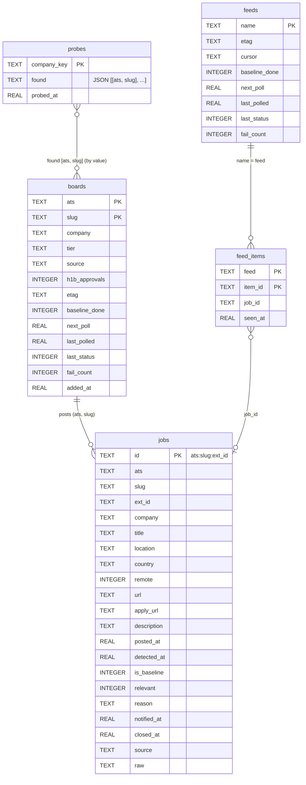
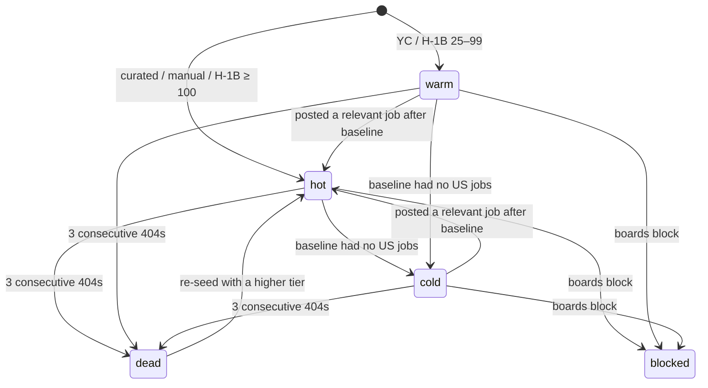
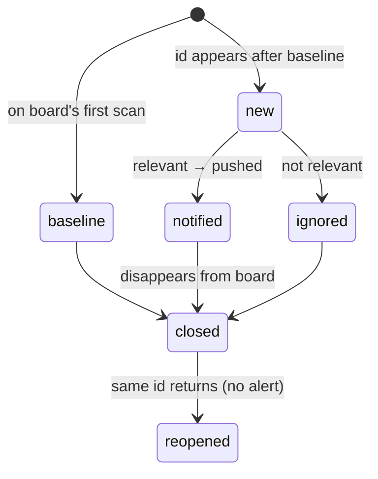

# 4. Data schema

_Reflects: Phase 2, part 1 (2026-10-20). Source of truth: `src/applypilot/db.py` (`SCHEMA`, `MIGRATIONS`) and `src/applypilot/models.py`._

The database lives at `~/.applypilot/applypilot.db` (SQLite, `journal_mode=WAL`, `synchronous=NORMAL`,
autocommit). The schema is created idempotently on every `connect()` (`CREATE … IF NOT EXISTS`).
Columns added after a table shipped are listed in `db.MIGRATIONS`; `connect()` adds any that are
missing (`ALTER TABLE … ADD COLUMN`). Only additive changes are supported; see
[07](07-roadmap-and-improvements.md) L-7.

## 4.1 Entity relationships

There are no foreign-key constraints. `jobs (ats, slug)` refers to `boards (ats, slug)` by convention,
and `boards block` deletes that board's jobs.

## 4.2 `boards`: one row per ATS job board being polled

| Column | Type | Meaning |
|---|---|---|
| `ats` | TEXT, PK | `greenhouse` · `lever` · `ashby` |
| `slug` | TEXT, PK | Board token in the ATS URL (e.g. `stripe`, `ramp`) |
| `company` | TEXT | Display name from the seed (never overwritten once set) |
| `tier` | TEXT | `hot` · `warm` · `cold` · `dead` · `blocked` (§4.5) |
| `source` | TEXT | Where it came from: `curated` · `yc` · `h1b` · `manual` · a feed name (`github:SimplifyJobs/New-Grad-Positions`, `hn`) |
| `h1b_approvals` | INTEGER, null | USCIS FY approvals for the matched employer (sponsor signal) |
| `etag` | TEXT, null | Last ETag; sent as `If-None-Match` |
| `baseline_done` | INTEGER 0/1 | 1 after the first successful (200) scan |
| `next_poll` | REAL (unix s) | When the board is due again |
| `last_polled` | REAL, null | Last poll attempt |
| `last_status` | INTEGER, null | HTTP status of the last poll (0 = network error) |
| `fail_count` | INTEGER | Consecutive non-200/304 results; reset on success |
| `added_at` | REAL | Insert time |

Index: `boards_due (next_poll) WHERE tier NOT IN ('dead','blocked')`.

## 4.3 `jobs`: one row per posting ever seen

| Column | Type | Meaning |
|---|---|---|
| `id` | TEXT, PK | `"{ats}:{slug}:{ext_id}"`, the same for a job whether a board poll or a feed found it |
| `ats`, `slug`, `ext_id` | TEXT | Board and the ATS's own job id. Feed jobs on ATSs we don't poll: `workday` (`tenant.wdN/site`, requisition id), `smartrecruiters` (company, numeric id), `workable` (account, shortcode), `other` (host, first 16 hex of the SHA-1 of the cleaned URL). |
| `company`, `title`, `location` | TEXT | As published (`location` joins secondary locations with `|` for Ashby) |
| `country` | TEXT, null | `US`, `GB`, … when the ATS gives it (Lever `country`; Ashby postal addresses, `US` if any location is in the US) |
| `remote` | INTEGER 0/1 | ATS remote flag or "remote" in the location |
| `url` | TEXT | Public posting URL |
| `apply_url` | TEXT | Application form: Greenhouse `job-boards.greenhouse.io/{slug}/jobs/{id}`, Lever `…/apply`, Ashby `…/application` |
| `description` | TEXT | Plain text. Empty for Greenhouse baseline jobs (fetched only for new relevant ones). |
| `posted_at` | REAL, null | ATS publish time: GH `first_published`, Lever `createdAt`, Ashby `publishedAt` |
| `detected_at` | REAL | When ApplyPilot first saw it. **Detection latency = `detected_at − posted_at`** for non-baseline jobs. |
| `is_baseline` | INTEGER 0/1 | 1 = seen on the board's first scan (not "new") |
| `relevant` | INTEGER, null | 1/0 from the relevance gate; null = not evaluated |
| `reason` | TEXT | Verdict text, e.g. `new-grad tech role, US`, `senior/lead/manager title`, `hard drop: requires security clearance` |
| `notified_at` | REAL, null | When the push was sent |
| `closed_at` | REAL, null | When it disappeared from the board; cleared if it reappears. Feed-only jobs (non-pollable ATS) are never closed yet. |
| `source` | TEXT | `ats` (found by a board poll) or the feed that found it **first**. Added by migration. |
| `score` | REAL, null | Priority 0–100 from `rank.score` (null = not screened: no description yet) |
| `sponsorship` | TEXT, null | `offers` / `no` / `unknown`, read from the description |
| `everify` | INTEGER 0/1, null | Description mentions E-Verify |
| `flags` | TEXT (JSON list), null | Soft knockouts: `3+ years required`, `PhD required`, `contract (C2C/1099)`, `clearance preferred`, `citizenship preferred`, `export-control mention` |
| `screened_at` | REAL, null | When `rank.screen` last ran. A hard drop sets `relevant=0` and `reason='hard drop: …'`. |
| `fit`, `variant` | REAL / TEXT, null | Best pre-built resume variant for this JD and its ATS score (`fit.py`); null until variants exist |
| `tailored_pdf`, `tailored_score` | TEXT / REAL, null | A resume tailored to this job by `applypilot tailor` and its final ATS score |
| `raw` | TEXT (JSON) | ATS payload minus bulky HTML; for feed jobs, the feed row (Simplify: sponsorship, degrees, category) |

Indexes: `jobs_board (ats, slug) WHERE closed_at IS NULL` and `jobs_new (detected_at) WHERE relevant = 1`.

## 4.4 `probes`: slug-probe cache, one row per company

| Column | Meaning |
|---|---|
| `company_key` | `company_key(name)`: lowercase alphanumerics with legal suffixes removed (`GOOGLE LLC` → `google`) |
| `found` | JSON list of `[ats, slug]` hits (may be `[]`) |
| `probed_at` | Unix time |

A hit is cached for good. A `[]` (no board) result expires after 30 days (`add_companies(negative_ttl_s=…)`),
or after 1 day when `resolve_by_name` asks. Delete the row to force a re-probe.

## 4.4a `feeds`: one row per cross-employer feed

| Column | Meaning |
|---|---|
| `name` | Stable key: `github:{owner}/{repo}`, `hn` or `jsearch:{query}` |
| `etag` | Last ETag (GitHub lists) |
| `cursor` | Feed-specific position. HN: `{"thread": id, "since": newest comment time}`; a new month's thread resets it. JSearch: unused (it fetches the recent window). |
| `baseline_done` | 1 after the first 200: later leads are "new" and can push |
| `next_poll`, `last_polled`, `last_status`, `fail_count` | As for boards; errors double the next interval |

## 4.4b `feed_items`: leads already processed

| Column | Meaning |
|---|---|
| `feed`, `item_id` (PK) | The feed and its own id for the lead (Simplify listing id, HN comment id, JSearch `job_id`) |
| `job_id` | `jobs.id` the lead resolved to (job leads), or null (company leads, unresolvable links) |
| `seen_at` | Unix time |

## 4.5 State machines

**Board tier**

`add_board` only raises a tier (`TIER_RANK`: dead −1 < cold 0 < warm 1 < hot 2), never touches
`blocked`, and never raises a board that went cold after its baseline (only the poller's promotion
does, B-012).

**Job lifecycle**

Phase 4 adds an `applications` table: `queued → tailored → approved → applied → response →
interview → offer | rejected`.

## 4.6 In-memory models (`models.py`)

| Type | Fields |
|---|---|
| `ATS` (StrEnum) | `GREENHOUSE`, `LEVER`, `ASHBY`: the ATSs whose boards are polled |
| `Board` | `ats, slug, company, tier, etag, baseline_done` |
| `Job` | `ats` (`ATS` or a plain string for feed-only kinds), `slug, ext_id, title, company, location, country, remote, url, apply_url, description, posted_at, source, raw`; property `id` |
| `Link` (resolver) | `ats, slug, ext_id, url, new_board`; properties `pollable`, `job_id`, `apply_url` |
| `Lead` (feeds) | `item_id, company, title, urls, location, country, posted_at, website, drop_reason, description, raw` |
| `FeedResult` (feeds) | `status, etag, cursor, leads, error` |
| `FeedStats` (feeds) | `feeds, unchanged, errors, leads, new_jobs, known_jobs, resolved_by_name, new_boards, probed, relevant, fresh_baseline` |
| `BoardResult` | `status` (200/304/404/0), `etag`, `jobs`, `error` |
| `Verdict` (relevance) | `relevant, reason, new_grad` |
| `Seed` (seeds) | `name, website, tier, source, h1b_approvals` |
| `PollStats` (poller) | `polled, unchanged, errors, new_jobs, relevant[(Job, reason)], fresh_baseline[...], latencies_s` |

## 4.7 Files

### `~/.applypilot/config.yaml` (created by `init`)
| Key | Default | Meaning |
|---|---|---|
| `ntfy_topic` | random `applypilot-<token>` | Phone push topic. Secret: anyone who knows it can read the alerts. |
| `ntfy_server` | `https://ntfy.sh` | Self-hostable |
| `mac_notifications` | `true` | macOS banners |
| `tiers.hot / warm / cold` | 150 / 900 / 10800 s | Poll intervals before jitter |
| `max_concurrency` | 24 | Global in-flight requests |
| `per_host_concurrency` | 6 | In-flight requests per ATS |
| `timeout_s` | 20 | HTTP timeout |
| `fresh_hours` | 48 | Baseline jobs younger than this go into the digest |
| `hot_h1b_threshold` | 100 | H-1B employers with at least this many approvals start in the hot tier |
| `feeds.github_lists` | Simplify New-Grad-Positions, vanshb03 New-Grad-2026 | Repos publishing `.github/scripts/listings.json` |
| `feeds.github_interval` | 300 | Seconds between list fetches (the CDN caches 300 s) |
| `feeds.hn` / `feeds.hn_interval` | `true` / 1800 | HN "Who is hiring" feed |
| `feeds.jsearch.api_key` | empty (feed off) | **Secret.** Set with `feeds set-key jsearch`, which writes the file with mode 600 |
| `feeds.jsearch.provider` | `rapidapi` | or `openwebninja` (direct) |
| `feeds.jsearch.queries` | 4 queries (SWE new grad, entry-level SWE, entry-level MLE, entry-level DS) | One feed per query |
| `feeds.jsearch.monthly_requests` | 200 | The plan's quota; pacing uses 90% of it |
| `feeds.jsearch.num_pages` / `country` / `employment_types` / `min_interval` | 1 / `us` / `FULLTIME` / 900 | Search parameters and the fastest allowed pace |
| `feeds.gmail` / `feeds.gmail_interval` | `true` / 120 | Job-alert email feeds (active only once `gmail login` has run) |
| `tailor.resume_dir` | `~/Documents/Resume` | Master resume, its `CLAUDE.md` fact base, `variants/`, `tailored/` |
| `tailor.scorer` | `~/.claude/skills/resumetailor/scripts/ats_score.py` | Imported for fit scoring |
| `tailor.claude_bin` / `timeout_s` / `parallel` | `claude` / 1800 / 2 | Headless tailoring sessions |
| `feeds.gmail_testing` | `true` | The Google Cloud app is in Testing (7-day sign-in): push a reminder on day 6. Set `false` after publishing to production. |

### `~/.applypilot/profile.yaml` and `answers.yaml`
Copied from `profile/*.example.yaml` by `init`; the personal copies are never committed.
- **profile:** name, contact, links, education, resume paths, target locations.
- **answers:**
  - `work_authorization`: authorized Yes, F-1 OPT/STEM OPT, sponsorship now No / future Yes, not a
    citizen or PR.
  - `availability`: start January 2027, graduation December 2026, willing to relocate.
  - `compensation`, `eeo` (all "decline"), `misc`.
- Read by the Phase 4 autofill.

### Gmail files (all mode 600, never committed)
| File | Written by | Contents |
|---|---|---|
| `~/.applypilot/gmail_client_secret.json` | you (downloaded from Google Cloud) | The Desktop OAuth client: `installed.{client_id, client_secret, token_uri, ...}` |
| `~/.applypilot/gmail_token.json` | `gmail login` | `refresh_token`, `access_token`, `expires_at`, `obtained_at`, `email`. Scope `gmail.readonly` only. |
| `~/.applypilot/samples/{site}-{message id}.eml` | `gmail samples` | Raw alert emails for building parser fixtures (directory mode 700) |
| `~/.applypilot/gmail_notices.json` | the email feeds | `{reminded, expired}`: the sign-in (`obtained_at`) each notice was last pushed for, so each is sent once |

Email feeds' `feeds.cursor` is `{"since": <epoch s>, "seen": [message ids]}`: the next search is `after:since`
(5 min overlap), and messages already parsed inside the overlap are skipped. `feed_items.item_id` is
`<message id>:<card index>`.

### Resume files (outside the repo, in `tailor.resume_dir`)
| Path | Contents |
|---|---|
| `variants/<name>/jd.txt` | The archetype JD (title, company, URL, description) the variant is tailored to |
| `variants/<name>/<master pdf name>` + `.tex` | The variant resume (same file name as the master, as recruiters see it) |
| `variants/<name>/report.md`, `final_score.txt` | The skill's report (changes, gaps, knockouts, unconfirmed tools) and final ATS score |
| `variants/<name>/batch_result.json` | ApplyPilot's record of the run: score, PDF, knockouts, unconfirmed tools, cost, seconds, error |
| `tailored/<company>-<title>/…` | The same, for `applypilot tailor JOB_ID` |

### Logs
- `~/.applypilot/poller.log`: Python logging (poll and feed warnings; httpx only at WARNING). Rotates
  at 5 MB, keeping 3 old files.
- `~/.applypilot/run.log`: stdout/stderr of the launchd agent, unbuffered. Cycle summaries are printed
  every 5 min, or at once when a job is pushed, a baseline digest appears, or an error occurs.
